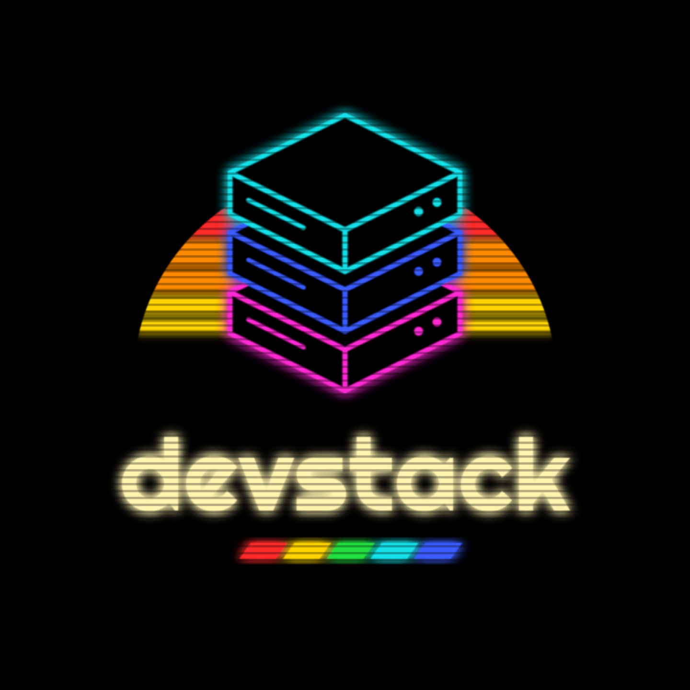

<p align="center"></p>

Devstack runs the local services of your team in dependency order, across every repository.

Devstack is optimised for coding agents, not for people. An agent drives the whole lifecycle of a local dev environment over [MCP](https://modelcontextprotocol.io). It builds the environment, starts a service, reads the logs of that service, and reads the trace that shows the failure. You paste no output. The CLI does the same job, when you want it.

Devstack runs on [Tilt](https://tilt.dev). One daemon serves the whole machine. One OpenTelemetry backend serves every workspace.

## Why

Your services live in many repositories. To run one, you first run the ones that it depends on. You hold that map in your head.

devstack holds the map. Then it gives you four things:

- **Two features at one time.** A [feature stack](REFERENCE.md#feature-stacks) runs the services that a feature needs, from git worktrees, on its own ports. Databases and stores run once, as the [shared set](REFERENCE.md#the-shared-set-and-the-replica). Neither feature blocks the other.
- **A stack that stops by itself.** Each stack stops 24 hours after you create it or bring it up. devstack keeps its worktrees, so `stack up` starts it again.
- **A stack that cleans up after itself.** A [hook](REFERENCE.md#hooks) provisions the state that a stack needs beyond this machine, and removes that state when the stack goes.
- **The failure, and not a guess.** Every copy reports to [one backend](REFERENCE.md#observability), stamped with its workspace, service, stack and environment.

## Install

```bash
go install github.com/socialviolation/devstack@main
```

devstack needs Go 1.25+ and [Tilt](https://docs.tilt.dev/install.html) on `$PATH`. If you turn on local observability, devstack also needs Docker.

### Host support

devstack uses a systemd user session when the host has one. Without one, it falls back: Tilt runs as a plain background process, the logs go to `~/.local/share/devstack/_devstack-host/tilt.log`, and the services have no memory or CPU limits.

- **Linux with systemd.** Tilt runs as its own user unit, `devstack-tilt`. The logs go to journald. Each service runs in its own scope, with the limits in [`runtime.limits`](REFERENCE.md#services). To check, run `systemctl --user status devstack-tilt`.
- **Linux without a user session** (SSH login, server). To get the systemd path, run `loginctl enable-linger $USER`, then log in again. If you do not, the fallback runs.
- **macOS.** The fallback runs.
- **WSL.** Set `systemd=true` under `[boot]` in `/etc/wsl.conf`, then run `wsl --shutdown`. If you do not, the fallback runs.

## Quick start

devstack configures itself. Give this section to a coding agent, or do the steps yourself.

**1. Read the CLI.** The root help is grouped by task, and every command explains itself.

```bash
devstack --help            # set up this machine, work on a feature, point it somewhere
devstack help more         # otel, tunnel, ports, hooks, dependencies, shared
devstack <command> --help
```

**2. Register the workspace.** A workspace is the one directory that holds every service of your product.

```bash
devstack workspace add ~/dev/my-workspace
```

devstack writes `devstack.workspace.yaml`, registers the directory on this machine, and builds the [replica](REFERENCE.md#the-shared-set-and-the-replica) that the shared set runs from. This command starts nothing.

**3. Generate a service file. Run this once for each service.**

```bash
devstack init --name=api --path=~/dev/my-workspace/api --cmd="go run ." --port=8080
```

devstack writes the manifest `devstack.service.yaml` in the directory of the service, adds the repository to the workspace manifest, writes `.mcp.json`, and generates the daemon configuration again. It reads the language from `go.mod`, `package.json`, `requirements.txt` or `*.csproj`. To name the language yourself, pass `--language`. If a directory runs more than one service, read [Registering a service](REFERENCE.md#registering-a-service).

**4. Start it.**

```bash
devstack workspace up      # start the dev daemon and the shared set (and the collector, if enabled)
devstack stack create feat-x --repos api   # a stack that runs api and what api needs
devstack stack up feat-x
devstack status            # what runs, on which port, pointing where
```

**5. Brief every session.**

```bash
devstack init --all --claude-hook
```

`--claude-hook` writes a Claude Code `SessionStart` hook into each service repository. Each session then starts with [`devstack prime`](REFERENCE.md#briefing-an-agent), which prints where the agent is, every copy of the service, what runs now, and what each environment is for. devstack commits no instructions to your repositories, so no fact goes stale.

CAUTION: `.claude/settings.json` is a committed file. The hook runs for everyone who clones the repository. If you do not want that, leave the flag out.

Now open Claude Code in any service repository. It reads `.mcp.json` and gets the devstack [tools](REFERENCE.md#mcp).

## Updating devstack

```bash
devstack upgrade           # install, migrate, then restart what runs
devstack status            # make sure that the daemon and the services still answer
```

Nothing upgrades on its own. devstack runs a daemon that serves right now, so an upgrade is explicit. The session briefing tells you when one is worth doing.

`upgrade` installs the current devstack, runs each pending migration, then restarts each shared service that runs now. To read what a migration does, and change nothing, run `devstack migrate --list`.

CAUTION: The restart step acts on services that serve right now. devstack restarts only the copies that were already running. This step is slow.

Two jobs stay with you. Restart your agent session, because an MCP server reads its tool descriptions only when it starts. Then read the git diff that a migration made in each service repository, and commit that diff. devstack neither commits nor pushes.

The flags are in [Updating devstack](REFERENCE.md#updating-devstack).

## Concepts

| Term | Meaning |
|------|---------|
| Workspace | A directory with a `devstack.workspace.yaml` manifest. It groups one or more services. |
| Service | A process that a service manifest defines: an API, a worker, an importer. The manifest is `devstack.service.yaml`, or `devstack.<name>.yaml` for each service after the first one in that directory. |
| Group | A named set of services that you start and stop together. |
| Host daemon | One Tilt daemon (`:10300`) for the whole machine. The shared set of every workspace runs inside it, and so does every stack that is up. Each service runs as `<workspace>:<service>` when it is shared, and as `<workspace>:<service>:<stack>` in a stack. There is no daemon for each workspace. |
| Template | Your own checkout of a service. It holds the git objects, the workspace manifest and the machine-local gitignored configuration. It runs nothing. |
| Shared service | A service in the `shared:` list of the workspace manifest. It runs once for the workspace, and never in a stack. Every stack uses it. Databases and stores are shared. |
| Shared set | All the shared services of one workspace. `workspace up` starts it. It runs from the replica, at the latest default branch, and devstack refreshes it every hour. |
| Replica | One git worktree for each repository that holds a shared service, under `<parent>/.devstack-base/<workspace>/`. devstack builds the replica from the template. Each worktree is detached at the default branch tip of its repository. |
| Feature stack | The services that one feature needs, in git worktrees, on their own ports. Its members are the services that you name, and every service that they `need`. A service that a member only `calls` does not come in. Every service that is not shared runs only in a stack. |
| Copy | One running process of a service. A shared service has one copy. Each stack that has a service as a member runs its own copy. |
| Stop time | The time when devstack stops a stack. It is 24 hours after `stack create` or `stack up`. `devstack stack extend` pushes it back. devstack keeps the worktrees, and never removes the stack. |
| Environment | A named set of configuration values (`environments:` in the workspace manifest). devstack applies it at workspace scope, service scope or stack scope. It sets where a service points. |
| Hook | A shell command that devstack runs on a lifecycle event, for example a stack created or a service started. A disposable stack uses hooks to provision and de-provision the state that it needs outside this machine. |

## What else is here

- [Environments](REFERENCE.md#environments) point a service at a different database or endpoint. You touch no code.
- [Addresses](REFERENCE.md#addresses) print the tailnet URL of a service, across all three hops. [Tunnels](REFERENCE.md#tunnels) forward the ports to another machine over SSH.
- [The panel](REFERENCE.md#the-panel) watches the machine in a terminal, and starts, stops and opens one service.
- [MCP](REFERENCE.md#mcp) lists the tools that an agent gets, and the commands that still need a shell.
- [Files, and what to commit](REFERENCE.md#files-and-what-to-commit) says which artifact belongs in git, and which one is machine-local.

Every command, flag and file is in the [reference](REFERENCE.md).
